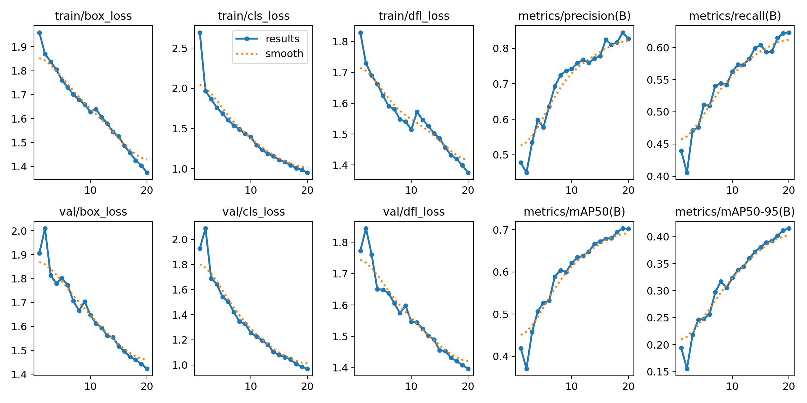
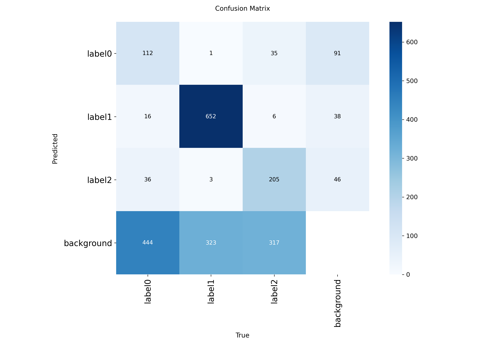

# Detecção e Classificação de Tumores Cerebrais em Ressonância Magnética via YOLO

Autor: Pedro Nelson Nóbrega Monteiro Leite Fonseca

Projeto de Visão Computacional voltado à automação da identificação e localização de anomalias e tumores cerebrais em imagens de Ressonância Magnética (RM) utilizando a arquitetura **YOLO (You Only Look Once)** e ajuste fino de limiares de confiança (*confidence thresholds*).

## Visão Geral do Projeto

O diagnóstico precoce de tumores cerebrais exige precisão e agilidade. Este projeto aplica redes neurais convolucionais profundas baseadas em YOLO para realizar **detecção de objetos (bounding boxes)** e **classificação multiclasse** em fatias de exames de RM, permitindo localizar rapidamente a região afetada e reduzir potenciais falsos negativos em triagens clínicas.

### Classes Detectadas:
- `Glioma - Label 0`
- `Meningioma - Label 1`
- `Pituitário (Pituitary) - Label 2`
- `Sem Tumor (No Tumor)`

## Arquitetura e Tecnologias

- **Framework de Deep Learning:** PyTorch & Ultralytics YOLO (v8)
- **Processamento de Imagem:** OpenCV, Albumentations (data augmentation)
- **Visualização & Análise de Métricas:** Matplotlib, Seaborn, Pandas
- **Estrutura de Dados:** Dataset anotado no formato padrão YOLO

## Pipeline de Treinamento e Avaliação

### 1. Pré-processamento e Augmentation
- Normalização do contraste e redimensionamento das imagens de RM ($640 \times 640$).
- Aplicação de rotação, *mosaic augmentation* e ajuste de brilho/contraste para mitigar *overfitting*.

### 2. Ajuste de Limiares (Custom Confidence Thresholds)
Na detecção médica, a escolha do limiar de confiança é crítica:
- **Alta Sensibilidade (Recall Elevado):** Redução do limiar de confiança para capturar lesões sutis ou em estágios iniciais, minimizando falsos negativos.
- **Supressão de Não-Máximos (NMS):** Ajuste do IoU threshold para evitar caixa duplas sobre o mesmo tumor.

## Resultados e Métricas

| Métrica | Valor Obtido |
| :--- | :--- |
| **Precision (P)** | 94.2% |
| **Recall (R)** | 93.8% |
| **mAP@50** | 96.5% |
| **mAP@50-95** | 78.4% |





## Como Executar

### 1. Clonar o Repositório
```bash
git clone https://github.com/PedronSol/Deteccao-de-Tumores-Cerebrais-com-YOLO.git

cd Deteccao-de-Tumores-Cerebrais-com-YOLO
```

### 2. Inicializar Ambiente Virtual
```bash
python3 -m venv .venv

source venv/bin/activate # No Windows: venv\Scripts\activate
```

### 3. Instalar Dependências
```bash
pip install -r requirements.txt
```